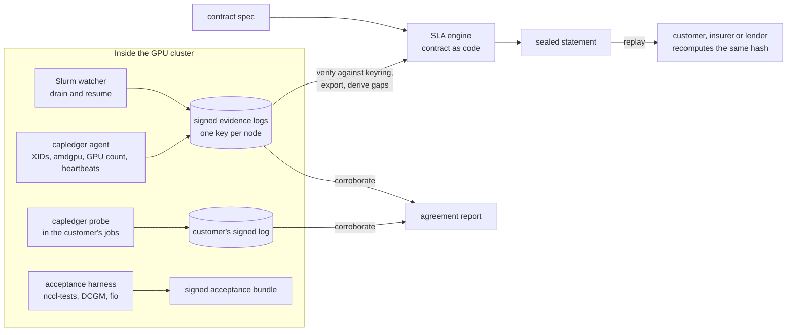

# gpu-sentinel

[](https://github.com/Sievehouse/gpu-sentinel/actions/workflows/ci.yml)

**Contract-grade acceptance tests and SLA evidence for rented GPU clusters.**

Capacity Ledger gives a GPU provider, its customer and their financiers one neutral, replayable record of the capacity that was actually delivered: a signed acceptance bundle when a cluster is handed over, then a monthly SLA statement that either party can recompute from the same signed events and get the same hash, and a corroboration report that compares the provider's record with the customer's own.

> **Status: pre-alpha (v0.2.0).** Everything here is implemented and tested on synthetic data. Nothing has been validated on production GPU clusters yet, and AMD support has not been run on AMD hardware. Example contracts are illustrative and are not legal advice.

## Why this exists

- **Delivered quality varies widely.** SemiAnalysis tested 77 GPU clouds for [ClusterMAX 3.0](https://newsletter.semianalysis.com/p/clustermax-30-the-industry-standard) (September 2026) and gave only 19 a medallion rating; its injected faults found health checks that missed failures or took hours to return nodes.
- **Contracts are standardising, measurement is not.** Providers and buyers now negotiate acceptance tests, downtime definitions and service credits, but each side measures with its own scripts and dashboards, so disputes are argued from support tickets.
- **Capital now needs the evidence.** Insurers sell parametric SLA cover and [lenders are starting to require it](https://capacityglobal.com/market-intelligence/data-centre-sla-risk-parametric-insurance-financing-2026/). A parametric trigger is only as good as the measurement behind it.
- **"Passed burn-in" is not "healthy".** ByteDance reports that synthetic microbenchmarks [miss over 60% of GPUs with silent data corruption](https://www.usenix.org/conference/osdi26/presentation/zheng), so acceptance has to be followed by continuous, comparable evidence.

## What is in v0.2

| Component | Language | What it does | Status |
| --- | --- | --- | --- |
| `capledger sla compute / verify` | Go | Contract spec (YAML or JSON) + events → sealed SLA statement; independent replay | Unit, property and CLI tests; v0.1 hashes pinned |
| `capledger sla corroborate` | Go | Provider and tenant events for one contract → node-by-node agreement report | Worked example pinned by tests |
| `capledger evidence / events / keyring` | Go | Ed25519-signed, hash-chained logs with a Merkle root; per-node keys; keyrings with owners, roles, node bindings and validity windows; heartbeat gap detection | Tamper, binding and gap tests |
| `capledger bundle` | Go | Signed `.tar.gz` evidence bundles; streaming verification; safe extraction | Tamper tests and fuzzing |
| `capledger agent` | Go, stdlib only | Kernel log → NVIDIA XID/SXID and AMD amdgpu observations; AMD RAS counters; GPU count; heartbeats → signed events | Tested on sample logs and a fake sysfs, not yet on GPU hosts |
| `capledger probe` | Go, stdlib only | Tenant side: GPU visibility and a benchmark floor with hysteresis → the customer's own signed events and heartbeats | Tested with simulated tool output |
| `deploy/slurm/slurm-state-watcher.sh` | Bash | Slurm drain and resume → signed down and up events | Tested against a fake `sinfo` |
| `capledger-harness plan / run / report` | Python | Acceptance plan (audit, DCGM or RVS, RDMA, NCCL or RCCL, burn-in, storage), runner, per-node verdicts | Tested with simulated tool output |
| `capledger-harness localize-sim / outliers` | Python | Group-testing fault localisation; slow-node detection against peers | Tested in simulation |
| `harness/scripts/burnin.py`, `gemm_bench.py` | Python, PyTorch | Simultaneous GEMM and all-to-all burn-in; per-GPU GEMM benchmark for the probe | Reference code; not yet run on hardware |

What changed since v0.1 is in the [changelog](CHANGELOG.md).

## Quickstart

Requirements: Go 1.22+ and Python 3.10+. The Go code has no third-party dependencies.

```bash
make build                              # bin/capledger
python3 -m venv .venv && . .venv/bin/activate
pip install -e "harness[dev]"           # capledger-harness
make test                               # Go and Python tests
./scripts/demo.sh                       # end-to-end on synthetic data, a few seconds
```

### Compute an SLA statement

```bash
./bin/capledger sla compute \
  --contract examples/contracts/hgx-16-node.yaml \
  --events   examples/events/hgx-16-node-2026-10.jsonl \
  --period 2026-10 --out statement.json --format text
```

```text
Contract      example-neocloud--example-lab--2026 (version 1)
Period        2026-10-01T00:00:00Z to 2026-11-01T00:00:00Z
Nodes         16 x 8 GPUs
Availability  99.7021%
Downtime      283.73 GPU-hours across 5 node(s); 16200 node-seconds excluded
Credit        5% (availability below 99.9%) = 15000.00 USD

Node            Downtime(s)  Excluded(s)  Incidents
gpu-003                8880            0  2026-10-03T04:12:00Z 8880s [node xid:79]
gpu-005                3600            0  2026-10-01T00:00:00Z 3600s [node xid:48]
gpu-010                   0        10800
gpu-011                7200            0  2026-10-20T01:00:00Z 7200s [node emergency-patch unannounced-maintenance]
gpu-012                   0         5400
gpu-014               14400            0  2026-10-25T12:00:00Z 14400s [node nccl-busbw-below-floor]
gpu-016               93600            0  2026-10-30T22:00:00Z 93600s [node network:rail-3-link-down]

statementSha256 d6280aea2086f9bf153922421dffbc4d44fbe17cc1106ba5184cad29f99323fc
```

Every number above is worked out by hand in [docs/sla-spec.md](docs/sla-spec.md), along with what happens when nodes stop sending heartbeats.

### Replay it as the other party

```bash
./bin/capledger sla verify --statement statement.json \
  --contract examples/contracts/hgx-16-node.yaml \
  --events   examples/events/hgx-16-node-2026-10.jsonl
# replay OK: same inputs, same statement d6280aea... (engine semantics 0.1.0)
```

### Record evidence on a node

```bash
./bin/capledger agent --node gpu-003 --source kmsg --log evidence-gpu-003.jsonl --key-dir keys/gpu-003
#   created signing key 655425e979f67bef in keys/gpu-003; heartbeats every minute
./bin/capledger event emit --log evidence-gpu-003.jsonl --key-dir keys/gpu-003 \
  --node gpu-003 --type up --cause node-reseated --source provider-health-check

./bin/capledger keyring import --keyring keyring.json --log evidence-gpu-003.jsonl \
  --owner "Example Neocloud" --role provider-agent        # trusts the key for gpu-003 only
./bin/capledger evidence verify --log evidence-gpu-003.jsonl --keyring keyring.json
./bin/capledger events export   --log evidence-gpu-003.jsonl --keyring keyring.json --derive-gaps 5m > events.jsonl
```

Each node signs with its own key, announced in its log; the keyring decides which keys to trust and for which nodes ([keys and keyrings](docs/keys-and-keyring.md)). `--derive-gaps` turns silences in the heartbeats into unmonitored time, which every statement reports. For a monthly statement, export all nodes' logs together with `--period 2026-10 --contract …`, so that a node that sent no heartbeat at all is flagged too. The agent only reads: it never resets GPUs, drains nodes or touches the scheduler. On AMD hosts add `--vendor amd` ([AMD GPUs](docs/amd-gpus.md)).

### Compare the provider's record with the customer's

The customer runs `capledger probe` inside its own jobs and keeps its own signed log. At the end of the month:

```bash
./bin/capledger sla corroborate --contract examples/contracts/hgx-16-node.yaml --period 2026-10 \
  --events-a examples/events/hgx-16-node-2026-10.jsonl \
  --events-b examples/events/hgx-16-node-2026-10-tenant.jsonl
```

```text
Contract   example-neocloud--example-lab--2026 (version 1), 2026-10-01T00:00:00Z to 2026-11-01T00:00:00Z
provider   availability 99.7021%, downtime 127680 node-seconds, credit 5%
tenant     availability 99.6823%, downtime 136160 node-seconds, credit 5%
Agreement  93.63% of all recorded downtime is seen by both; 5 node(s) in dispute
```

The report lists every stretch that only one side recorded; [docs/tenant-probe.md](docs/tenant-probe.md) explains each one.

### Plan, run and sign an acceptance run

```bash
capledger-harness plan --inventory examples/inventory/hgx-4-node.yaml --out plan.json
capledger-harness run --plan plan.json --out results.jsonl --dry-run     # print every command
capledger-harness run --plan plan.json --out results.jsonl --stage audit --stage single_node
capledger-harness report --results results.jsonl --cluster example-hgx-32gpu --expected-gpus 8 \
  --criteria examples/criteria/hgx-h100-400g.yaml --out report.json --markdown report.md
./bin/capledger bundle create --out acceptance.tar.gz --type acceptance --subject example-hgx-32gpu \
  --key-dir keys/harness --file report.json --file report.md --file results.jsonl --file plan.json
./bin/capledger bundle verify --bundle acceptance.tar.gz --pub keys/harness/capledger.pub.pem
capledger-harness localize-sim --nodes 64 --bad 2     # 2 bad nodes found in about 23 tests, not 2,016 pairs
```

For AMD Instinct clusters, set `vendor: amd` in the inventory (`examples/inventory/mi300x-2-node.yaml`).

## How it works



1. **Collect.** Agents, probes, integrations and the harness write signed entries to per-source evidence logs, each with its own key. Each entry carries the hash of the previous one, so edits, deletions and reordering are detectable, and heartbeats make silence visible.
2. **Compute.** The SLA engine replays availability events against the contract spec: minimum incident length, scheduled-maintenance and customer-caused exclusions, a per-node exclusion cap, a rack rule for NVL72-style systems, unmonitored time, and credit tiers. All arithmetic is exact (no floating point in the money path).
3. **Prove.** The statement is sealed with a SHA-256 over its canonical JSON and fingerprints its inputs. Anyone with the contract and the signed events gets the same statement. The customer's own record shows where the two views differ.

Details: [architecture](docs/architecture.md), [SLA spec](docs/sla-spec.md), [keys and keyrings](docs/keys-and-keyring.md), [tenant probe](docs/tenant-probe.md), [AMD GPUs](docs/amd-gpus.md), [acceptance tests](docs/acceptance-tests.md), [evidence formats](docs/evidence-format.md), [threat model](docs/threat-model.md).

## Repository layout

```text
capacity-ledger/
├── cmd/capledger/            CLI, one file per area: agent, probe, sla, evidence, bundle, keys
├── internal/
│   ├── agent/                kernel-log follower, fault handling, GPU count, heartbeats
│   ├── bundle/               signed evidence bundles
│   ├── canonical/            deterministic JSON for hashing
│   ├── contract/             contract SLA spec: load (YAML or JSON) and validate
│   ├── events/               availability events: load, normalise, order
│   ├── evidence/             signed hash-chained log, keys, announcements, Merkle root
│   ├── gaps/                 heartbeat silences → unmonitored time
│   ├── interval/             exact interval-set arithmetic
│   ├── keyring/              trusted keys: owners, roles, node bindings, validity
│   ├── probe/                tenant-side GPU visibility and benchmark probe
│   ├── sla/                  SLA engine, sealed statements, corroboration
│   ├── xid/                  NVIDIA XID/SXID and AMD amdgpu parsing, RAS counters, policy
│   └── yamlite/              strict YAML subset reader for contracts
├── harness/                  Python acceptance harness (capledger-harness)
│   ├── src/capledger_harness/  plan, runner, report, baseline, localize, parsers
│   ├── scripts/              burnin.py, gemm_bench.py
│   └── tests/
├── examples/                 contracts, events, inventories, criteria, policies, sample tool output
├── deploy/                   Kubernetes DaemonSet and tenant probe job, Dockerfile, Slurm watcher and probe
├── docs/                     architecture, spec, keys, probe, AMD, tests, formats, threats, roadmap
└── scripts/                  demo.sh, rename-module.sh
```

## Design principles

- **Deterministic money path.** Same inputs, same statement, same hash, on any machine. Integer seconds and exact rationals only.
- **Two vantage points.** The provider's agent and the customer's probe record the same nodes from opposite sides, and corroboration shows exactly where they differ; neither party has to trust the other's dashboard.
- **Least privilege.** The agent and the probe only read, have no third-party dependencies and run without root on most hosts. Every writer has its own key, and a key can speak only for the nodes it is enrolled for.
- **Silence is evidence too.** A collector that stops leaves a visible gap; the contract decides whether that gap counts as downtime.
- **Reuse proven tools.** nccl-tests, rccl-tests, DCGM, the ROCm Validation Suite, perftest and fio do the measuring; this project orchestrates them, compares results and keeps the evidence.
- **No AI in verdicts or credits.** A wrong number here moves money. Language models may later draft incident summaries, always linked to the signed records.
- **Honest limits.** An acceptance report says "no defect found by these tests", never "no defect exists".

## Roadmap

Next (v0.3): a hosted multi-party ledger with provider, customer and financier roles, co-signed monthly statements and a daily Merkle-root exchange. See [docs/roadmap.md](docs/roadmap.md), which also holds the 30-day validation plan this project is gated on.

## Contributing, security and licence

See [CONTRIBUTING.md](CONTRIBUTING.md) and [SECURITY.md](SECURITY.md). Licensed under the [Apache License 2.0](LICENSE).
