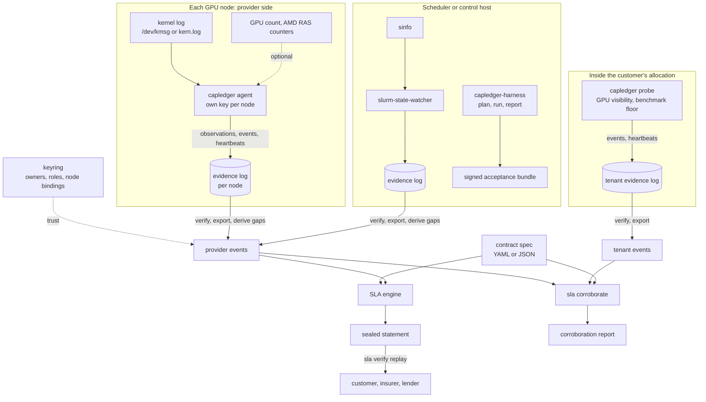

# Architecture

Capacity Ledger has two vantage points feeding signed, replayable records. Only the SLA engine turns evidence into money, and it does so deterministically.

## Components

| Component | Responsibility | Not responsible for |
| --- | --- | --- |
| Agent | Parse NVIDIA XID/SXID and AMD amdgpu kernel messages and AMD RAS counters, record every one as a signed observation, emit `down` events for node-level faults per the policy, count GPUs, write heartbeats | Remediation, draining, scheduling, closing incidents |
| Tenant probe | From inside the customer's allocation, check that every GPU is visible and (optionally) that a benchmark stays above a floor; write signed events and heartbeats to the customer's own log | Diagnosing why a GPU is missing |
| Integrations (Slurm watcher; later Kubernetes, NVSentinel, ticketing) | Turn the provider's own repair and health state into `down` / `up` events | Deciding what the contract means |
| Acceptance harness | Plan and run standard tests (NVIDIA or AMD), parse results, compare nodes with peers, localise faulty nodes, produce verdicts; the CLI signs the results as a bundle | Certifying the absence of defects |
| Evidence log | Append-only, hash-chained, signed JSON Lines; one writer and one key per file | Storage, replication, retention (planned service) |
| Keyring | Which keys to trust, who holds them, which nodes they may speak for, and when | Proving who holds a key (enrolment is a human decision) |
| Gap detection | Turn silences in heartbeats into `unmonitored_start` / `unmonitored_end` events | Deciding what silence means (the contract does) |
| SLA engine | Contract spec + events + period → statement with exact arithmetic; replay verification; corroboration of two event sets | Interpreting free-text contracts |
| Evidence bundles | Freeze a set of files (an acceptance report and its raw results, a statement and its inputs) under one signature | Storing them |

## Data flow and consistency

- **Single writer per log.** Each agent, probe or integration owns its log file and key, so no locking or coordination is needed; logs merge at read time. Event ids embed the key id and sequence number, so they never collide.
- **Event ordering.** Time, then `seq`, then `id`. Integrations that can emit several transitions per second set `seq`.
- **Stateless collectors.** Apart from the log itself, the agent keeps only a short suppression window and the last RAS readings in memory, and the probe only its current run of good or bad checks. A restart cannot invent data. It can only leave a gap, and gaps in heartbeats become visible unmonitored time.
- **Verification before use.** `events export` verifies the exact bytes it then reads against the keyring, and exports nothing if any entry fails.
- **Replayability.** A statement fingerprints the canonical contract and the sorted, normalised events and records the engine semantics it needs. Replays that need semantics the binary does not have are refused rather than silently compared.

## Technology choices

| Area | Choice | Reason |
| --- | --- | --- |
| Agent, probe and engine | Go, standard library only | One static binary per platform; nothing to audit beyond this repository; easy for a counterparty to run a replay |
| Contract specs | YAML (a strict subset, parsed by `internal/yamlite`) or JSON | Readable for lawyers and engineers; no third-party parser in the money path |
| Signatures | Ed25519 (`crypto/ed25519`), PKCS#8/PKIX PEM keys | Small, fast, deterministic signatures; no external libraries |
| Hashing | SHA-256 over canonical JSON with a domain prefix | Formatting changes cannot change hashes; hashes from different structures cannot collide by construction |
| Evidence commitment | RFC 6962 Merkle tree hash | Standard, simple, lets a statement commit to the exact evidence set |
| Bundles | tar + gzip from the standard library, signed manifest first | Opens with ordinary tools; verifiable in one streaming pass |
| Harness | Python 3.10+, PyYAML | Test tooling and PyTorch live in Python; the harness only orchestrates proven tools |
| Arithmetic | Integer seconds, `math/big.Rat` | No floating point in anything that becomes money |

## Deployment shapes

- **Today (v0.2):** the agent as a Kubernetes DaemonSet or systemd unit on each GPU node, each with its own key; the Slurm watcher on the controller; the tenant probe inside the customer's jobs; the CLI wherever statements are computed, replayed or corroborated.
- **Planned:** a hosted ledger service (PostgreSQL with append-only event tables plus object storage for raw results and bundles) giving provider, customer and financier roles read access to their own contracts, co-signing of monthly statements, daily Merkle-root exchange, and a self-hosted bundle for sovereign or air-gapped sites. A modular monolith, not microservices.

## Extension points

- Fault policy files (`--policy`), versioned and recorded in every observation; an `xid` section for NVIDIA and an `amd` section for amdgpu classes.
- New event sources: anything that can call `capledger event emit` or write the same signed entry format.
- Contract spec versions (`apiVersion`); the engine refuses unknown fields rather than guessing.
- Bundle types: any lowercase slug, so new kinds of frozen evidence need no format change.
