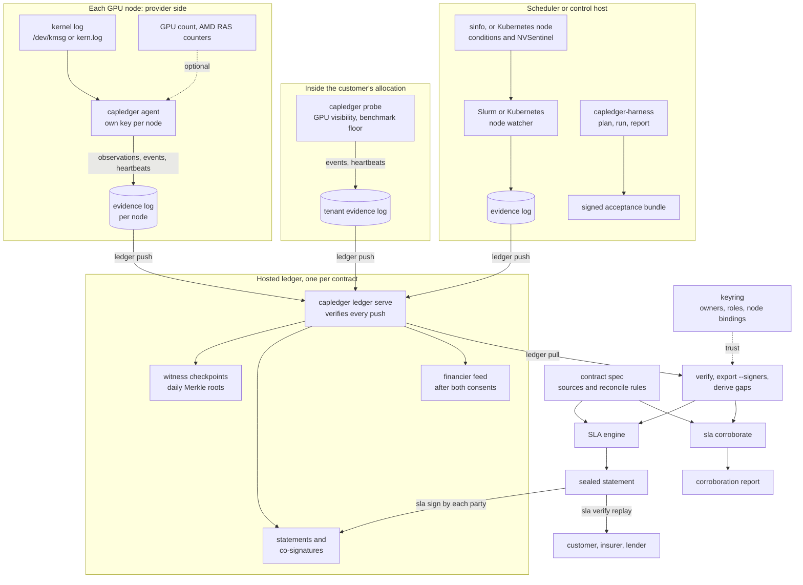

# Architecture

GPU Sentinel has two vantage points feeding signed, replayable records. Only the SLA engine turns evidence into money, and it does so deterministically. The hosted ledger (since 0.3) moves those records between the parties and witnesses them, but computes nothing: every document it hands out can be verified offline with the same commands.

## Components

| Component | Responsibility | Not responsible for |
| --- | --- | --- |
| Agent | Parse NVIDIA XID/SXID and AMD amdgpu kernel messages and AMD RAS counters, record every one as a signed observation, emit `down` events for node-level faults per the policy, count GPUs, write heartbeats | Remediation, draining, scheduling, closing incidents |
| Tenant probe | From inside the customer's allocation, check that every GPU is visible and (optionally) that a benchmark stays above a floor; write signed events and heartbeats to the customer's own log | Diagnosing why a GPU is missing |
| Integrations (Slurm watcher; Kubernetes node watcher, which also reads NVSentinel and node-problem-detector conditions; later ticketing) | Turn the provider's own repair and health state into `down` / `up` and `degraded` events | Deciding what the contract means |
| Acceptance harness | Plan and run standard tests (NVIDIA or AMD), parse results, compare nodes with peers, localise faulty nodes, produce verdicts; the CLI signs the results as a bundle | Certifying the absence of defects |
| Proof-of-value kit | Inject the roadmap's faults on test nodes and undo them, plan the trial matrix, score detections against the pass thresholds, measure agent overhead | Running on production clusters |
| Evidence log | Append-only, hash-chained, signed JSON Lines; one writer and one key per file | Proving its newest entries were not cut off (checkpoints do) |
| Checkpoints | Signed log heads (size, last hash, Merkle root) that fix history once the other party or a witness holds them | Saying anything about entries written after them |
| Keyring | Which keys to trust, who holds them, their role, which nodes they may speak for, and when | Proving who holds a key (enrolment is a human decision) |
| Gap detection | Turn silences in heartbeats into `unmonitored_start` / `unmonitored_end` events | Deciding what silence means (the contract does) |
| SLA engine | Contract spec + events + period → statement with exact arithmetic; sources allow-list; reconciliation of the two parties' clocks; replay verification; corroboration of two event sets | Interpreting free-text contracts |
| Statement signatures | Each party's signed `accept` or `dispute` of a sealed statement; co-signing checks | Resolving disputes |
| Evidence bundles | Freeze a set of files (an acceptance report and its raw results, a statement and its inputs) under one signature | Storing them |
| Ledger service | Receive and verify pushed log entries, keep one owner per log, sign witness checkpoints, keep statements, signatures and consents, serve the financier feed; one contract per process, or several from one configuration directory, each with its own keyring, data and URL | Computing statements, deciding disputes, holding private keys of the parties |
| SLA reference implementation | An independent Python implementation of the SLA rules, compared with the engine in CI | Producing statements for contract use |

## Data flow and consistency

- **Single writer per log.** Each agent, probe or integration owns its log file and key, so no locking or coordination is needed; logs merge at read time. Event ids embed the key id and sequence number, so they never collide. On the ledger, a log belongs to the party that pushed it first.
- **Incremental, verified pushes.** `ledger push` sends only the entries the ledger does not hold yet; the ledger accepts them only if they continue its stored chain, verify against its keyring and come from keys whose role the pushing party may write for. A push that does not continue the chain is refused with the ledger's head, never merged.
- **Event ordering.** Time, then `seq`, then `id`. Integrations that can emit several transitions per second set `seq`.
- **Stateless collectors.** Apart from the log itself, the agent keeps only a short suppression window and the last RAS readings in memory, and the probe only its current run of good or bad checks. The Kubernetes watcher rebuilds which nodes it last recorded as down from its own log when it starts, so a restart neither repeats nor forgets an open outage. A restart cannot invent data. It can only leave a gap, and gaps in heartbeats become visible unmonitored time.
- **Verification before use.** `events export` verifies the exact bytes it then reads against the keyring, and exports nothing if any entry fails. With `--signers` it stamps each event with its signer's keyring role, which the contract's sources use.
- **Replayability.** A statement fingerprints the canonical contract and the sorted, normalised events and records the engine semantics it needs. Replays that need semantics the binary does not have are refused rather than silently compared.

## Technology choices

| Area | Choice | Reason |
| --- | --- | --- |
| Agent, probe, engine and ledger | Go, standard library only | One static binary per platform; nothing to audit beyond this repository; easy for a counterparty to run a replay |
| Contract specs | YAML (a strict subset, parsed by `internal/yamlite`) or JSON | Readable for lawyers and engineers; no third-party parser in the money path |
| Signatures | Ed25519 (`crypto/ed25519`), PKCS#8/PKIX PEM keys, one domain string per document kind | Small, fast, deterministic signatures; a signature for one kind of document cannot be reused for another |
| Hashing | SHA-256 over canonical JSON with a domain prefix | Formatting changes cannot change hashes; hashes from different structures cannot collide by construction |
| Evidence commitment | RFC 6962 Merkle tree hash | Standard, simple, lets a statement or checkpoint commit to the exact evidence set |
| Bundles | tar + gzip from the standard library, signed manifest first | Opens with ordinary tools; verifiable in one streaming pass |
| Ledger storage | Plain files: append-only, fsynced logs; atomically written documents | Back up with any tool, inspect and verify with the ordinary commands, no database to operate for one contract |
| Ledger API | `net/http`, Go 1.22 routing patterns, bearer tokens stored as SHA-256 | Small surface; TLS from the binary or a proxy |
| Harness | Python 3.10+, PyYAML | Test tooling and PyTorch live in Python; the harness only orchestrates proven tools |
| Arithmetic | Integer seconds, `math/big.Rat` | No floating point in anything that becomes money |

## Deployment shapes

- **Today (v0.4):** the agent as a Kubernetes DaemonSet or systemd unit on each GPU node, each with its own key; the Slurm watcher on the controller, or the Kubernetes node watcher in the cluster (`deploy/kubernetes/node-watcher.yaml`); the tenant probe inside the customer's jobs; a ledger (`deploy/ledger/capledger-ledger.service` or `deploy/kubernetes/ledger-statefulset.yaml`) for one contract or, with `--config-dir`, for several, run by the provider, the customer or a neutral operator; the CLI wherever statements are computed, signed, replayed or corroborated, on Linux, macOS or Windows.
- **Planned:** PostgreSQL and object-storage backends for the ledger behind the same store interface, for operators who host many contracts; a self-hosted bundle for sovereign or air-gapped sites. A modular monolith, not microservices.

## Extension points

- Fault policy files (`--policy`), versioned and recorded in every observation; an `xid` section for NVIDIA and an `amd` section for amdgpu classes.
- New event sources: anything that can call `capledger event emit` or write the same signed entry format, admitted by a contract through its `sources`.
- Contract spec versions (`apiVersion`); the engine refuses unknown fields rather than guessing.
- Bundle types: any lowercase slug, so new kinds of frozen evidence need no format change.
- Ledger storage: `internal/ledger.Store` is the only code that touches the data directory.
