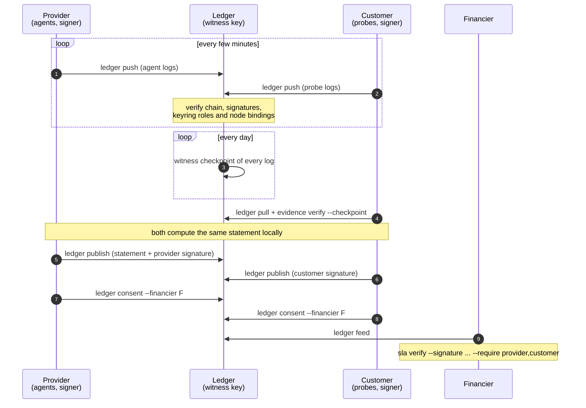

# The hosted ledger

`capledger ledger serve` runs one ledger for one contract. Both parties push their signed evidence logs to it, a witness key on the ledger signs a checkpoint of every log every day, the monthly statements sit there with each party's signature, and financiers read a feed once both parties have consented.

The ledger is deliberately not an authority. It computes nothing: statements are computed and checked by the parties with `capledger sla compute` and `sla verify`, as without a ledger. It verifies everything it accepts against a keyring, but everything it hands out is signed by someone else's key (or by its own witness key, for checkpoints) and can be verified offline. The provider, the customer or a neutral third party can run it.



## Roles

The configuration names exactly one provider, one customer, and any number of financiers and auditors. Each party has a bearer token; the ledger stores only its SHA-256.

| Action | Provider | Customer | Auditor | Financier |
| --- | --- | --- | --- | --- |
| Push logs (signed by keys whose keyring role is in the party's `writeRoles`) | yes | yes | no | no |
| Read logs, heads and checkpoints; request a checkpoint | yes | yes | yes | no |
| Upload statements | yes | yes | no | no |
| Read statements and signatures | yes | yes | yes | through the feed |
| Upload a signature (only as its own role) | yes | yes | yes | while its feed is open |
| Grant or revoke a financier's consent (only as its own role) | yes | yes | no | no |
| Read the feed | preview | preview | preview | while both consents are grants |

A log belongs to the party that pushed it first; nobody else can write to it. The feed contains statements, their signatures and the checkpoints, never raw logs.

## Setting one up

The commands below use the example names from `deploy/ledger/ledger.example.json`.

**1. Keys and keyring.** The ledger verifies pushed entries, signatures and consents against a keyring, which both parties should also hold. It contains the node keys (enrolled from their announcements), each party's signing key and the ledger's witness key.

```bash
capledger keyring import --keyring keyring.json --log gpu-001.jsonl ... --owner "Example Neocloud" --role provider-agent
capledger keyring import --keyring keyring.json --log probe-gpu-001.jsonl ... --owner "Example Lab" --role tenant-probe
capledger keygen --out provider-signer      # on the provider's side; the customer does the same
capledger keyring add --keyring keyring.json --pub provider-signer/capledger.pub.pem --owner "Example Neocloud" --role provider
capledger keyring add --keyring keyring.json --pub customer-signer/capledger.pub.pem --owner "Example Lab" --role customer
```

**2. Tokens and configuration.** For every party, create a token, give the token to the party and put its hash in the configuration:

```bash
capledger ledger token --out example-neocloud.token
#   tokenSha256  4b6f…  (put this in the ledger configuration)
```

```json
{
  "apiVersion": "capacity-ledger/v1alpha1",
  "kind": "LedgerConfig",
  "contract": "example-neocloud--example-lab--2026",
  "parties": [
    {"name": "example-neocloud", "role": "provider", "tokenSha256": "4b6f…", "writeRoles": ["provider-agent", "provider-integration"]},
    {"name": "example-lab", "role": "customer", "tokenSha256": "90d1…", "writeRoles": ["tenant-probe"]},
    {"name": "example-insurer", "role": "financier", "tokenSha256": "c3a8…"}
  ]
}
```

`contract` must be the contract's `metadata.id`; the ledger refuses statements for other contracts.

**3. Run it.**

```bash
capledger ledger serve --config ledger.json --keyring keyring.json \
  --data /var/lib/capledger-ledger/data --key-dir /var/lib/capledger-ledger/witness \
  --listen 127.0.0.1:8443 --checkpoint-every 24h
```

It creates its witness key on first start and prints its id. Serve it over TLS: either `--tls-cert` and `--tls-key`, or a TLS-terminating proxy in front of it. `deploy/ledger/capledger-ledger.service` is a hardened systemd unit and `deploy/kubernetes/ledger-statefulset.yaml` a single-replica StatefulSet; both use the same static binary as the agent.

**4. Enrol the witness.** Every party reads the witness key from the ledger and adds it to its own keyring, so that it can verify checkpoints:

```bash
capledger ledger status --server https://ledger.example.com --token-file example-lab.token --witness-pub witness.pub.pem
#   ledger    contract example-neocloud--example-lab--2026; you are example-lab (customer); witness key 1f0c2a9b3e7d4c55
capledger keyring add --keyring keyring.json --pub witness.pub.pem --owner "Ledger operator" --role witness
```

Compare the key id with the one the operator saw at start-up.

## Day to day

**Push** from wherever logs are written, for example every five minutes from a systemd timer or cron. Only entries the ledger does not hold yet are sent, and a file that does not extend the ledger's copy is refused rather than merged:

```bash
capledger ledger push --server https://ledger.example.com --token-file example-neocloud.token \
  --log /var/lib/capledger/evidence-gpu-001.jsonl --log /var/lib/capledger/evidence-gpu-002.jsonl
```

**Pull and verify** the other party's logs, against the latest witness checkpoint:

```bash
capledger ledger pull --all --out-dir logs --server ... --token-file example-lab.token
capledger ledger checkpoint --out checkpoint.json --server ... --token-file example-lab.token
capledger evidence verify --keyring keyring.json --checkpoint checkpoint.json --log logs/gpu-001.jsonl ...
```

Keep every checkpoint you fetch. Each one fixes the history of every log up to that day: if a log is later cut short or rewritten, it no longer matches the checkpoints you hold.

## Month end

Both parties export the events, compute the statement under the contract and check that they got the same hash; then each signs it and publishes the signature:

```bash
capledger events export --keyring keyring.json --signers --derive-gaps 5m --period 2026-10 --contract contract.yaml \
  --log logs/gpu-001.jsonl ... --log logs/probe-gpu-001.jsonl ... > events.jsonl
capledger sla compute --contract contract.yaml --events events.jsonl --period 2026-10 --out statement.json
capledger sla sign --statement statement.json --party customer --key-dir customer-signer          # or --decision dispute --note "…"
capledger ledger publish --statement statement.json --signature statement.customer.sig.json --server ... --token-file example-lab.token
```

`ledger publish` answers with the co-signing status; `ledger status` lists every statement with who accepted and who disputed it.

## Financiers

A financier sees nothing until both the provider and the customer have signed a consent for it:

```bash
capledger ledger consent --financier example-insurer --party provider --key-dir provider-signer --server ... --token-file example-neocloud.token
capledger ledger consent --financier example-insurer --party customer --key-dir customer-signer --server ... --token-file example-lab.token
```

Either party can close the feed again with `--revoke`. The financier then fetches the feed as files and checks it with the ordinary commands:

```bash
capledger ledger feed --out-dir feed --server ... --token-file example-insurer.token
capledger sla verify --statement feed/statements/2026-10-…json --signature feed/statements/2026-10-….1.provider.sig.json \
  --signature feed/statements/2026-10-….2.customer.sig.json --keyring keyring.json --require provider,customer
```

## API

All endpoints except `/healthz` need `Authorization: Bearer TOKEN`. Errors are JSON objects with an `error` field; a push that does not continue a log answers `409` with the ledger's `head`.

| Method and path | Who | What |
| --- | --- | --- |
| `GET /healthz` | anyone | `ok` |
| `GET /v1/info` | every party | Contract, the calling party, the witness key |
| `GET /v1/logs` | provider, customer, auditor | Every log: name, owner, entries, last hash, Merkle root |
| `GET /v1/logs/{name}?from=N` | provider, customer, auditor | The log's entries from index N, as JSON Lines |
| `GET /v1/logs/{name}/head` | provider, customer, auditor | One log's head |
| `POST /v1/logs/{name}` | provider, customer | Append entries (JSON Lines) that continue the log |
| `POST /v1/checkpoints` | provider, customer, auditor | Sign a checkpoint of every log now |
| `GET /v1/checkpoints`, `/latest`, `/{id}` | provider, customer, auditor | Checkpoint ids, the newest checkpoint, one checkpoint |
| `PUT /v1/statements` | provider, customer | Upload a sealed statement for the ledger's contract |
| `GET /v1/statements`, `/{sha}` | provider, customer, auditor | Statement summaries, one statement |
| `GET /v1/statements/{sha}/signatures` | provider, customer, auditor | Signatures and co-signing status |
| `POST /v1/statements/{sha}/signatures` | every party, as its own role | Upload a signature |
| `POST /v1/consents`, `GET /v1/consents` | provider and customer post; all read (financiers their own) | Feed consents |
| `GET /v1/feed[?financier=NAME]` | financiers; others preview with `financier` | Statements, signatures, checkpoints and the witness key |

## Operations

- **Data.** Everything lives under `--data` as plain files: `logs/NAME.jsonl` (append-only) and `NAME.owner`, `checkpoints/`, `statements/`, `signatures/`, `consents/`. Back up the data directory and the witness key directory. Every file can be checked with the ordinary commands.
- **Changing keys or parties.** Edit the keyring or configuration and send `SIGHUP` (`systemctl reload capledger-ledger`); the ledger keeps the old ones if the new files do not load. The contract id cannot change.
- **Rotating a token.** Create a new one with `ledger token`, replace the hash in the configuration, reload.
- **Rotating the witness key.** Stop the ledger, move the old key directory aside, start it (a new key is created), enrol the new key in every keyring and set `notAfter` on the old entry.
- **One writer.** Run a single ledger process per data directory.
- **Limits.** Pushes up to 64 MiB per request (`ledger push` splits larger ones), other documents up to 16 MiB. There is no rate limiting; put a proxy in front if the ledger faces the internet.

## Not yet

The ledger in 0.3 stores files on one host and serves one contract. PostgreSQL and object-storage backends for operators with many contracts, single sign-on, and rate limiting are planned; the store interface (`internal/ledger.Store`) is where they plug in.
